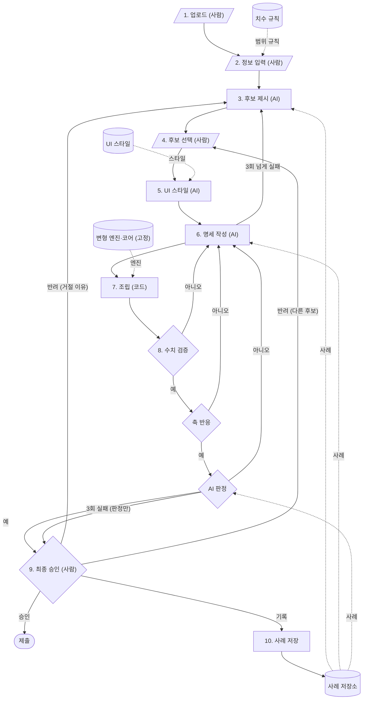

# three.js 구성기 자동 생성 계획

2026-10-22 (2026-10-26 수정: 용어는 `GLOSSARY.md`, 결정은 `docs/adr/`, 명세 구조는 `docs/spec-schema.md` 참고)

## 1. 목적

### 배경

- 쇼핑몰 고객이 치수를 바꿔 보려면 모델마다 three.js 구성기를 따로 구현해야 한다.
- CAD 파라미터는 이름이 없거나(d34) 식으로 얽혀 어느 값이 어느 치수인지 알기 어렵다.
- 기존 프로토타입(stool1)은 슬라이더 구성이 코드에 박혀 있어 모델마다 사람이 손봐야 한다.

### 목표

- CAD 모델과 사람이 준 정보로 쇼핑몰용 three.js 구성기(div)를 자동 생성한다.
- 피규어 등 다른 모델링으로의 범용화는 고정 엔진을 가구에서 검증한 뒤 진행한다.
- 사람의 선택·승인 기록을 쌓아 AI의 해석과 판정을 개선한다.

## 2. 파이프라인

| 구분 | 단계 | 담당 | 하는 일 |
| --- | --- | --- | --- |
| 준비 | 1. 업로드 | 사람 | 서버 연결 테스트 후 CAD 애드인으로 모델·스윕 결과 전송 (사용자 파라미터 전부를 기본값 ±50% 범위로 적응형 스윕, 최종 승인까지 연결 유지) |
|  | 2. 정보 입력 | 사람 | 상품명, 상품 종류, 원하는 슬라이더와 범위 메모, 두께 선택 노출 여부 |
|  | 3. 후보 제시 | AI | 대상 부품을 찾아 슬라이더 구성 후보 2~4개를 스윕 미리보기로 제시 (정면·부모 파라미터·두께 선택 노출이 서로 다름) |
|  | 4. 후보 선택 | 사람 | 후보 중 선택, 원하는 치수가 식에 묶인 자식이면 움직일 부모 선택 |
| 생성 | 5. UI 스타일 | AI | 스타일 목록에서 색·글꼴·슬라이더 모양 선택 |
|  | 6. 명세 작성 | AI | 슬라이더별 파라미터·범위·부모/자식·두께 선택을 JSON 명세로 작성 |
|  | 7. 조립 | 코드 | 고정 코어에 명세·스타일·스윕 결과를 넣어 구성기 생성 |
| 확인 | 8. 검증 | 코드·AI | 수치(치수·형상 오차, 두께 포함) → 축 반응 → AI 판정, 실패 시 슬라이더·부품별 원인을 6으로. 3회 넘게 실패하면 3으로, AI 판정만 3회 실패하면 이유를 붙여 9로 |
|  | 9. 최종 승인 | 사람 | 구성기를 직접 조작해 확인 후 승인(슬라이더 이름·범위는 여기서 수정), 반려하면 4로 돌아가거나 거절 이유를 적어 3으로 |
|  | 10. 제출·기록 | 코드 | 제출하고 결과를 사례로 저장 |

## 3. 스펙

| 항목 | 내용 |
| --- | --- |
| 입력 | CAD 모델(서드파티 업로드) + 사람 입력 (OBJ는 범용화 단계에서) |
| 출력 | 쇼핑몰에 넣는 three.js 구성기 (div 하나, JS 번들) |
| 코어 | 고정. 슬라이더 개수·두께 선택은 명세에서 읽어 UI 자동 구성 |
| 변형 엔진 | 스윕 결과로 꼭짓점 이동량을 섞는 고정 라이브러리 (직접 구현) |
| 조절 범위 | 폭·깊이·높이 (치수 규칙 ∩ 사람 입력 ∩ 스윕 범위). 두께는 연속 변경 없이 표준 두께 목록(3·6·9·12·15·18·24·30 mm)에서 앞뒤 한 칸 선택 |
| 정확도 | 부품 치수 오차 0.2 mm 이하, 형상 오차 max(1 mm, 대각선 0.1%) 이하 |
| 운영 | 로컬 서버(Docker, LAN), 무료·오픈소스 구성 |

### 데이터베이스

| DB | 내용 | 형식 | 만드는 단계 → 쓰는 단계 |
| --- | --- | --- | --- |
| 모델 | 파라미터·식, 스윕 결과, 메쉬 | JSON·메쉬 | 업로드 → 후보·조립·검증 |
| 명세 | 상품별 슬라이더↔파라미터, 범위, 부모/자식, 두께 | JSON | 명세 작성 → 조립·검증 |
| 치수 규칙 | 부위별 범위와 출처 | JSON | 준비 → 정보 입력·판정 |
| UI 스타일 | 색·글꼴·슬라이더 모양 | JSON | 준비 → UI 스타일 |
| 사례 | 결정 기록 (학습 겸용 형식, 지금은 예시로만 사용) | JSONL | 기록 → 후보·명세·판정 |
| 결과물 | 고정 코어 + 승인된 명세·스윕 데이터 | JS·JSON | 승인 → 쇼핑몰 |

## 4. AI 기술

| 기술 | 쓰는 단계 | 구현 |
| --- | --- | --- |
| LLM (텍스트 모델) | 후보, UI 스타일, 명세 작성 | gpt-oss-120b·20b (Cerebras) |
| VLM (이미지 모델) | 부품 탐색, AI 판정 | qwen3.8-27b (Cerebras) |
| 모델 중계 | 전체 | LiteLLM, 예비 Groq·로컬 모델 |
| 구조화 출력 | 후보, 명세, 판정 결과 | JSON Schema 검사 |
| RAG + 예시 주입 | 후보·명세·판정 | 사례 임베딩 검색(LanceDB) |
| 고정 워크플로 | 전체 | 순서는 코드, AI는 단계 안 |
| 비AI 계산 | 변형 엔진, 수치·축 검증 | 결정적 알고리즘 |

## 5. 테스트 케이스

- 실제 상품으로 개발·조정하고, 마지막에 처음 보는 상품 약 10개를 새로 등록해 최종 확인 (평가 전용)
